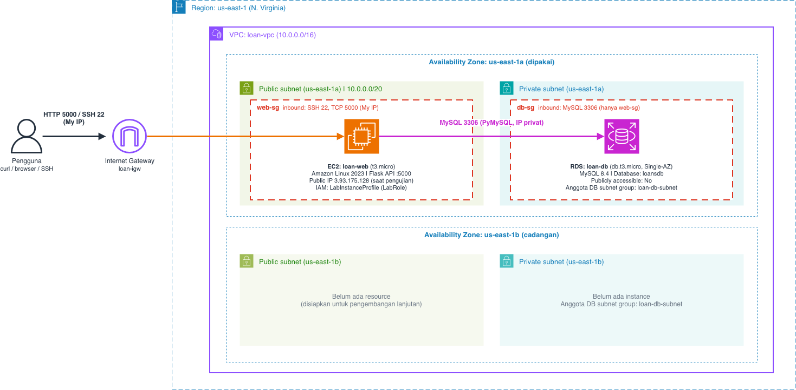

# AWS Equipment Loan System

**Bintang Khalifa Hadianto** (24/534951/TK/59312)

Proyek individu Komputasi Awan, Week 12: Design & AWS Setup. Sistem pencatatan peminjaman barang berupa REST API Flask yang berjalan di EC2 dan menyimpan data di RDS MySQL.

| | |
| --- | --- |
| **Use case** | Pencatatan peminjaman barang (siapa meminjam apa, kapan dipinjam, dan sudah kembali atau belum) |
| **Track** | A, Cloud VM (EC2 + RDS MySQL) |
| **Lingkungan** | AWS Academy Cloud Foundations Sandbox, region us-east-1 |

## Arsitektur



Alur request: pengguna → Internet Gateway → EC2 (Flask, port 5000) → RDS MySQL (port 3306, lewat IP privat).

- VPC `loan-vpc` (10.0.0.0/16) dengan dua subnet publik dan dua subnet privat di us-east-1a dan us-east-1b, tanpa NAT
- EC2 `loan-web` (t3.micro, Amazon Linux 2023) di subnet publik
- RDS `loan-db` (MySQL 8.4, db.t3.micro, Single-AZ) di subnet privat, tidak dapat diakses publik
- `web-sg`: SSH 22 dan TCP 5000 hanya dari IP pemilik
- `db-sg`: MySQL 3306 hanya dari `web-sg`
- IAM: LabInstanceProfile (LabRole) bawaan sandbox

## Data

Satu tabel `loans` di database `loansdb` (definisi lengkap di [`schema.sql`](schema.sql)).

| Kolom | Tipe | Aturan |
| --- | --- | --- |
| id | INT | Primary key, auto increment |
| equipment_name | VARCHAR(100) | Wajib |
| borrower_name | VARCHAR(100) | Wajib |
| loan_date | DATE | Wajib |
| return_date | DATE | Boleh kosong |
| status | ENUM('borrowed','returned') | Default `borrowed` |

## Endpoint

| Operasi | Endpoint | Body (JSON) | Respons |
| --- | --- | --- | --- |
| Create | `POST /loans` | `equipment_name`, `borrower_name`, `loan_date` | `{"id": ...}` |
| Read | `GET /loans` | tidak ada | Daftar peminjaman |
| Update | `PUT /loans/<id>` | field yang diubah (parsial) | `{"updated": n}` |
| Delete | `DELETE /loans/<id>` | tidak ada | `{"deleted": n}` |
| Cek koneksi | `GET /health` | tidak ada | `{"db_ok": 1}` |

Contoh:

```bash
curl -X POST http://localhost:5000/loans \
  -H "Content-Type: application/json" \
  -d '{"equipment_name":"Proyektor","borrower_name":"Andi","loan_date":"2026-11-25"}'
```

## Menjalankan aplikasi

Konfigurasi database lewat environment variable (lihat [`.env.example`](.env.example)): `DB_HOST`, `DB_USER`, `DB_PASSWORD`, `DB_NAME`.

```bash
pip3 install -r requirements.txt
mysql -h <RDS-ENDPOINT> -u admin -p loansdb < schema.sql

export DB_HOST=<RDS-ENDPOINT>
export DB_USER=admin
export DB_NAME=loansdb
read -s DB_PASSWORD && export DB_PASSWORD
python3 app.py
```

API berjalan di port 5000. Langkah lengkap pembuatan infrastruktur AWS ada di [`docs/deployment-plan.md`](docs/deployment-plan.md).

## Struktur repositori

```
app.py                  API Flask (CRUD loans + /health)
schema.sql              definisi tabel loans
requirements.txt        dependensi Python
.env.example            template variabel lingkungan
docs/architecture.png   diagram arsitektur
docs/deployment-plan.md rencana deployment
```

## Keamanan

- Password database tidak disimpan di repositori; dikirim lewat environment variable.
- File kunci `.pem` dan `.env` masuk `.gitignore`.
- Database tidak punya akses publik dan hanya menerima koneksi dari `web-sg`.
- Server Flask yang dipakai adalah development server, hanya untuk keperluan tugas ini.
